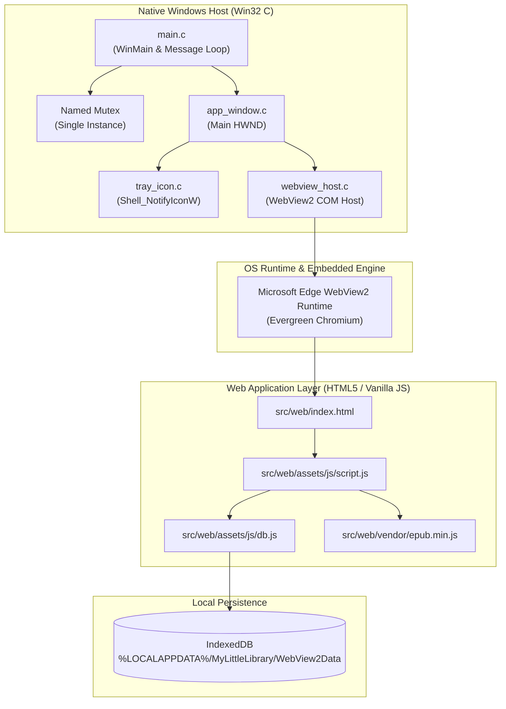
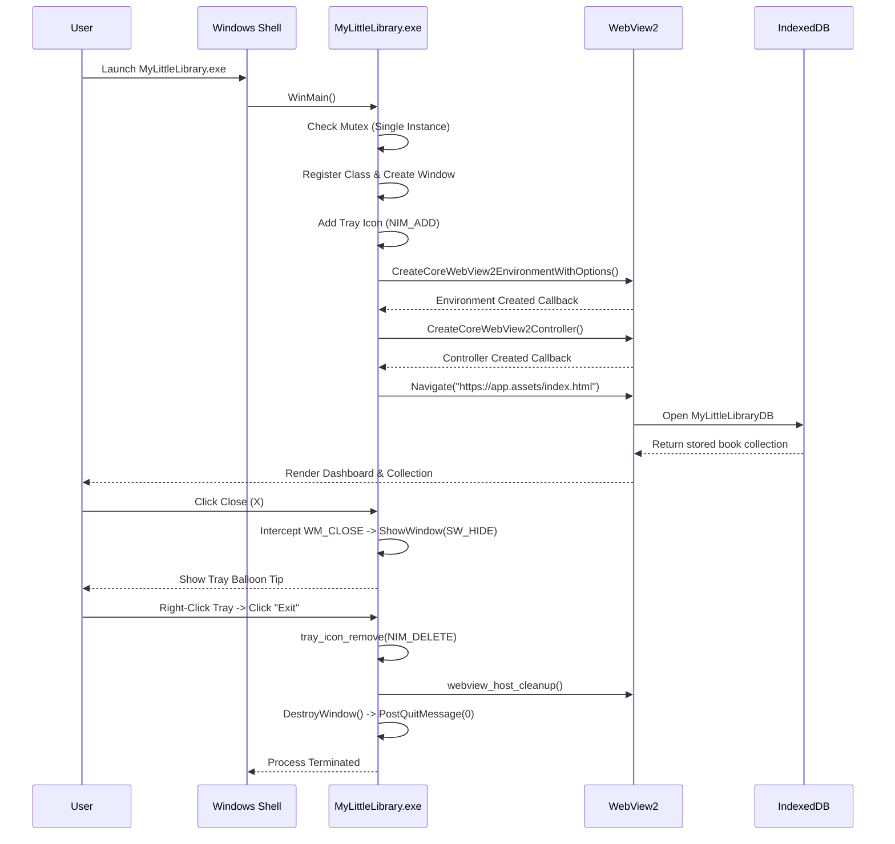

# Architecture & System Design Specification

**Application:** My Little Library — Windows Desktop Edition  
**Version:** 2.0.0  
**Target Platform:** Windows 10 & Windows 11 (64-bit)  

---

## 1. Architectural Overview

My Little Library Desktop adopts a hybrid **Native Shell + Embedded Web View** architecture. Instead of bundling Chromium and Node.js runtimes (such as Electron, which adds ~150MB+ overhead), the application utilizes a lightweight native Windows host written in C (Win32 API) combined with Microsoft WebView2 (powered by the OS-managed Evergreen Edge Chromium engine).

---

## 2. Native Host Subsystem (`src/native/`)

### 2.1 Process Entry & Single-Instance (`main.c`)
- **DPI-Awareness:** The entry point configures Per-Monitor V2 DPI awareness (`SetProcessDpiAwarenessContext(DPI_AWARENESS_CONTEXT_PER_MONITOR_AWARE_V2)`). This ensures crisp text, fonts, and controls on 4K monitors and laptops with display scaling (125%, 150%, 200%).
- **Named Mutex:** A system-wide mutex named `Global\MyLittleLibrary_SingleInstance_Mutex_v2` is acquired at startup. If another instance is already running (`ERROR_ALREADY_EXISTS`), the second process locates the primary window using `FindWindowW` and dispatches `WM_APP_RESTORE_INSTANCE`, bringing the existing window to the foreground, before cleanly exiting with code 0.
- **COM Initialization:** `CoInitializeEx(NULL, COINIT_APARTMENTTHREADED)` initializes the COM subsystem required for WebView2.

### 2.2 Window Management (`app_window.c` / `app_window.h`)
- **Window Class:** Registered under `MyLittleLibrary_WindowClass` with application icons (`IDI_APP_ICON`) and modern cursor styles.
- **Window Dimensions:** Default startup bounds are 1200x800 centered on the primary display. Minimum window dimensions (720x520) are enforced via `WM_GETMINMAXINFO` to guarantee responsive layout integrity.
- **Hide-to-Tray Lifecycle:**
  - Standard applications terminate when the user clicks the close button (X). In My Little Library, `WM_CLOSE` is intercepted to call `ShowWindow(hWnd, SW_HIDE)`.
  - On the first minimization to tray, a balloon tip informs the user that the application remains accessible from the system notification area.
  - Calling the explicit **Exit** action sends `DestroyWindow(hWnd)`, triggering `WM_DESTROY`, which properly unloads WebView2, deletes the tray icon, and calls `PostQuitMessage(0)`.

### 2.3 System Tray Integration (`tray_icon.c` / `tray_icon.h`)
- Implemented via `Shell_NotifyIconW` with `NOTIFYICONDATAW` version 4.
- **Left-Click / Double-Click:** Immediately restores the window (`SW_RESTORE`) and sets foreground focus (`SetForegroundWindow`).
- **Right-Click / Context Menu:** Displays a native popup menu containing:
  - **Open My Little Library** (default action in bold)
  - Separator
  - **Exit**
- Context menu activation adheres to standard Win32 guidelines (`SetForegroundWindow` -> `TrackPopupMenuEx` -> `PostMessage(hWnd, WM_NULL, 0, 0)`), preventing hanging popup menus.

### 2.4 WebView2 COM Host (`webview_host.c` / `webview_host.h`)
- **Dynamic Loading:** `WebView2Loader.dll` is dynamically loaded via `LoadLibraryW` and `GetProcAddress`. This decouples the compiler from MSVC-specific import libraries and allows descriptive error dialogs if the loader or runtime is absent.
- **User Data Isolation:** The user data folder is explicitly isolated to `%LOCALAPPDATA%\MyLittleLibrary\WebView2Data`. This avoids interfering with system Edge browser profiles or other apps.
- **Virtual Host Name Mapping:** Uses `ICoreWebView2_3::SetVirtualHostNameToFolderMapping` to map the local web directory to `https://app.assets/`. This provides:
  - Secure HTTPS origin semantics for IndexedDB.
  - Zero CORS complications when loading local EPUB packages or worker scripts.
  - Fallback to standard file URI if older runtime versions are encountered.

---

## 3. Web & Storage Subsystem (`src/web/`)

### 3.1 IndexedDB Storage Engine (`assets/js/db.js`)
Previous versions relied on `localStorage`, which stores data as Base64 strings. Because `localStorage` is synchronously blocking and limited to 5MB–10MB per origin, larger PDF/EPUB files regularly triggered quota overflow exceptions.

The desktop edition migrates all persistence to **IndexedDB** (`MyLittleLibraryDB`):
- **Object Store `books`:** Stores metadata JSON (id, title, author, category, status, notes, file metadata, timestamp) with indexes on `category`, `status`, and `addedAt`.
- **Object Store `files`:** Stores raw binary documents (`Blob`) indexed by `bookId`.
- **Legacy Migration:** At startup, `dbMigrateLegacyLocalStorage()` inspects `localStorage`. If legacy books and Base64 payloads exist, it parses them, saves them as native blobs into IndexedDB, and purges `localStorage`.

### 3.2 Offline Digital Reader
- **PDF Documents:** Rendered directly within an `<iframe>` leveraging the built-in PDF reader plugin of Edge/Chromium.
- **EPUB Documents:** Rendered via a locally bundled `epub.min.js` and `jszip.min.js` located in `src/web/vendor/`. No runtime internet access is required.
- **Memory Safety:** Whenever the reader panel closes, all active Object URLs (`URL.revokeObjectURL`) are revoked, and ePub rendition instances are destroyed to free memory immediately.

---

## 4. Resource & Build Lifecycle

