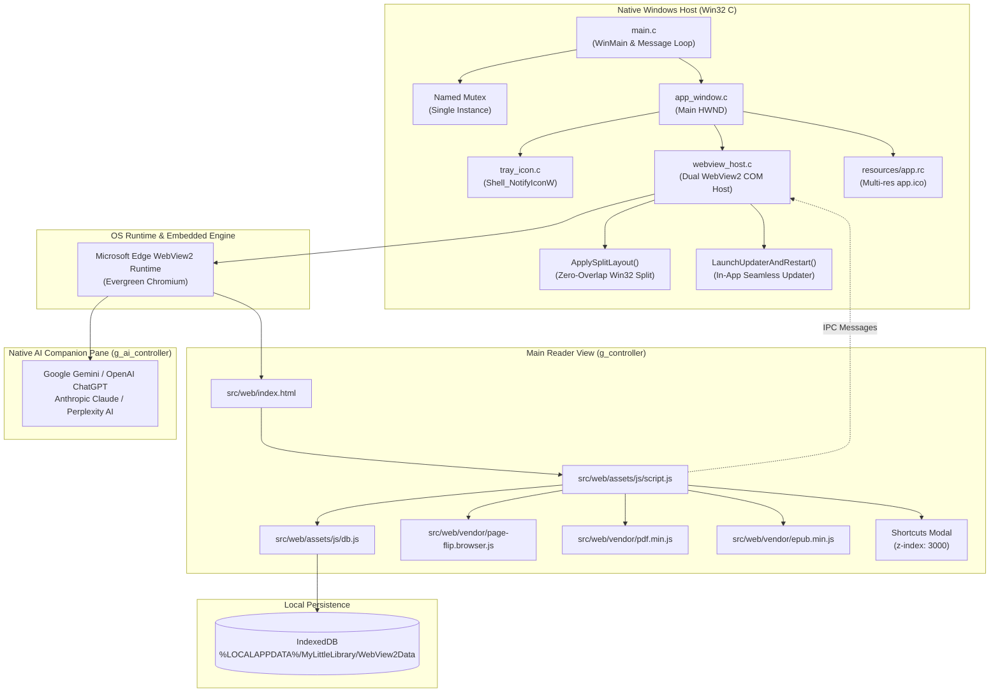

# Architecture & System Design Specification

**Application:** My Little Library — Windows Desktop Edition  
**Version:** 2.2.1  
**Target Platform:** Windows 10 & Windows 11 (64-bit)  

---

## 1. Architectural Overview

My Little Library Desktop adopts a hybrid **Native Shell + Embedded Web View** architecture. Instead of bundling Chromium and Node.js runtimes (such as Electron, which adds ~150MB+ overhead), the application utilizes a lightweight native Windows host written in C (Win32 API) combined with Microsoft WebView2 (powered by the OS-managed Evergreen Edge Chromium engine).

---

## 2. Native Host Subsystem (`src/native/`)

### 2.1 Process Entry & Single-Instance (`main.c`)
- **DPI-Awareness:** The entry point configures Per-Monitor V2 DPI awareness (`SetProcessDpiAwarenessContext(DPI_AWARENESS_CONTEXT_PER_MONITOR_AWARE_V2)`). This ensures crisp text, fonts, and controls on 4K monitors and laptops with display scaling (125%, 150%, 200%).
- **Named Mutex:** A system-wide mutex named `Global\MyLittleLibrary_SingleInstance_Mutex_v2` is acquired at startup. If another instance is already running (`ERROR_ALREADY_EXISTS`), the second process locates the primary window using `FindWindowW` and dispatches `WM_APP_RESTORE_INSTANCE`, bringing the existing window to the foreground, before cleanly exiting with code 0.
- **COM Initialization:** `CoInitializeEx(NULL, COINIT_APARTMENTTHREADED)` initializes the COM subsystem required for WebView2.

### 2.2 Window Management (`app_window.c` / `app_window.h`)
- **Window Class:** Registered under `MyLittleLibrary_WindowClass` with application icons (`IDI_APP_ICON`) and modern cursor styles.
- **Window Dimensions:** Default startup bounds are 1200x800 centered on the primary display. Minimum window dimensions (720x520) are enforced via `WM_GETMINMAXINFO` to guarantee responsive layout integrity.
- **Hide-to-Tray Lifecycle:**
  - Standard applications terminate when the user clicks the close button (X). In My Little Library, `WM_CLOSE` is intercepted to call `ShowWindow(hWnd, SW_HIDE)`.
  - On the first minimization to tray, a balloon tip informs the user that the application remains accessible from the system notification area.
  - Calling the explicit **Exit** action sends `DestroyWindow(hWnd)`, triggering `WM_DESTROY`, which properly unloads WebView2, deletes the tray icon, and calls `PostQuitMessage(0)`.

### 2.3 System Tray Integration (`tray_icon.c` / `tray_icon.h`)
- Implemented via `Shell_NotifyIconW` with `NOTIFYICONDATAW` version 4.
- **Left-Click / Double-Click:** Immediately restores the window (`SW_RESTORE`) and sets foreground focus (`SetForegroundWindow`).
- **Right-Click / Context Menu:** Displays a native popup menu containing:
  - **Open My Little Library** (default action in bold)
  - Separator
  - **Exit**

### 2.4 Dual WebView2 COM Host & Split Layout (`webview_host.c` / `webview_host.h`)
- **Dynamic Loading:** `WebView2Loader.dll` is dynamically loaded via `LoadLibraryW` and `GetProcAddress`. This decouples the compiler from MSVC-specific import libraries and allows descriptive error dialogs if the loader or runtime is absent.
- **User Data Isolation:** The user data folder is explicitly isolated to `%LOCALAPPDATA%\MyLittleLibrary\WebView2Data`. This avoids interfering with system Edge browser profiles or other apps.
- **Dual Controller Architecture:**
  - `g_controller` hosts the local application shell, catalog, and 3D flipbook reader.
  - `g_ai_controller` is an independent secondary top-level controller hosting live AI services (Gemini, ChatGPT, Claude, Perplexity).
- **True Win32 Non-Overlapping Split Layout (`ApplySplitLayout`):**
  - Solves DirectX swapchain occlusion between multiple controller surfaces by maintaining strictly partitioned client bounds:
    - Reader Pane: `(0, 0, clientWidth - 480, clientHeight)`
    - AI Companion Pane: `(clientWidth - 480, 0, clientWidth, clientHeight)`
  - Zero pixel overlap guarantees smooth DirectComposition rendering without visual artifacts, flicker, or z-order conflicts.
- **Desktop User-Agent Spoofing:** Configures `ICoreWebView2Settings2::put_UserAgent` with standard Edge/Chrome desktop UA strings to prevent Google Account OAuth login blocking (*"This browser or app may not be secure"*).
- **Native IPC Web Messages:**
  - `setAISidebarVisible`: Toggles AI pane split and resizes reader bounds.
  - `navigateAI`: Dynamically navigates `g_ai_webview` to the requested provider URL.
  - `reloadAI`: Refreshes the active AI session page.
  - `startSeamlessUpdate`: Triggers native background updater process.
- **Seamless In-App Updater:** Downloads update packages in background, triggers silent Inno Setup install (`/VERYSILENT /SUPPRESSMSGBOXES /NORESTART`), and restarts the application automatically.
- **Virtual Host Name Mapping:** Uses `ICoreWebView2_3::SetVirtualHostNameToFolderMapping` to map the local web directory to `https://app.assets/`. This provides:
  - Secure HTTPS origin semantics for IndexedDB.
  - Zero CORS complications when loading local EPUB packages, WOFF2 fonts, or worker scripts.
  - Fallback to standard file URI if older runtime versions are encountered.

---

## 3. Web, Reader & Art Subsystems (`src/web/`)

### 3.1 IndexedDB Storage Engine (`assets/js/db.js`)
Persistence is handled entirely through **IndexedDB** (`MyLittleLibraryDB`):
- **Object Store `books`:** Stores metadata JSON (id, title, author, category, status, notes, file metadata, timestamp, custom cover base64) with indexes on `category`, `status`, and `addedAt`.
- **Object Store `files`:** Stores raw binary documents (`Blob`) indexed by `bookId`.
- **Legacy Migration:** At startup, `dbMigrateLegacyLocalStorage()` inspects `localStorage`. If legacy records exist, it parses them, saves them as native blobs into IndexedDB, and purges `localStorage`.

### 3.2 3D Physical Flipbook & Reader Engine
- **Default Focus Mode:** Opening any book automatically enters distraction-free reading. Bilah kontrol (*topbar* dan *toolbar*) tersembunyi secara otomatis saat membaca.
- **Manual Edge Eye Toggle:** Kontrol tidak akan muncul saat kursor bergerak; hanya muncul atau sembunyi saat tombol mata (`👁️` / `F`) ditekan.
- **Zero-Overlap Reader Layout:** Bilah topbar diposisikan melayang (*floating*) dengan margin aman sehingga tidak menimpa tombol mata atau kanvas buku.
- **PDF Documents (3D Flipbook):** Powered by `pdf.js` and `page-flip.js`. Renders double-page spreads with realistic turn-page animation, mouse corner dragging, dynamic spine crease gradients, and full zoom/pan support.
- **Standard View:** Provides continuous vertical scroll fallback for fast reading.
- **EPUB Documents:** Rendered via locally bundled `epub.min.js` with chapter pagination.
- **Dock Auto-Concealment:** When the reader opens, the bottom floating dock is automatically concealed via `body.reader-open` so controls are 100% unobstructed.

### 3.3 Manga Ink Signature Design System
- **Open Sans Typography:** Pure offline Latin WOFF2 subsets bundled in `assets/fonts/`.
- **Manga Screen-Tone Shadows:** Procedural 45° cross-hatching drop shadows with crisp pen borders.
- **High-Contrast Dark Mode Inversion:** Automatic inversion from rich black ink on paper to bright white/silver ink on dark background.
- **Procedural Hardcover Covers:** Books without cover artwork automatically render 3D cloth-bound hardcover objects with engraved borders and spine lighting.

---

## 4. Packaging & Distribution Subsystem

- **Inno Setup 6 Installer:** Compiled via `scripts/build-installer.ps1` into `dist/MyLittleLibrary-Setup-v2.2.1.exe` (3.8 MB). Installs the app to `{autopf}\My Little Library` or `{localappdata}\Programs`, creates Desktop and Start Menu shortcuts, and registers an uninstaller in Windows Settings.
- **Standalone Portable ZIP:** Assembled via `scripts/package.ps1` into `dist/MyLittleLibrary-v2.2.1-win64.zip` (2.1 MB) containing the native executable, dependencies, and web assets for instant zero-install execution.
